---

## 📊 At a glance

<table>
  <tr>
    <td align="center" width="25%">
       
      <h1>2,350+</h1>
      authored across all repos
    </td>
    <td align="center" width="25%">
       
      <h1>8</h1>
      production &amp; client systems
    </td>
    <td align="center" width="25%">
       
      <h1>4 yrs</h1>
      shipping since Jan 2023
    </td>
    <td align="center" width="25%">
       
      <h1>3</h1>
      PayNow · HitPay · SSLCommerz
    </td>
  </tr>
</table>

I build the systems behind a business's daily work: enquiries, quotes, contracts, job dispatch, invoicing, payments, payroll. My focus is getting the data flow right end to end, so the people using the software can trust what's on screen.

  

---

  

<table>
  <tr>
    <td align="center" width="33%">
      <h1>🧾 22K+</h1>
      <b>Job orders</b> scheduled, dispatched, completed
    </td>
    <td align="center" width="33%">
      <h1>💳 100K+</h1>
      <b>Successful payments</b> PayNow · HitPay
    </td>
    <td align="center" width="33%">
      <h1>🙋 10K+</h1>
      <b>Customers served</b> managed on the platform
    </td>
  </tr>
</table>

A live ERP that runs an air-conditioning service business end to end, from the first enquiry to the final payment. I've contributed to almost every module since 2024.

> [!TIP]
> **Self-sustaining contracts:** when a technician marks a job complete, the system books the next visit in the contract on its own. Recurring service runs without anyone re-entering it.

### 🧩 What I built

<table>
  <tr>
    <td width="33%" valign="top">
       
      <b>~100 commits</b>
      <ul>
        <li>Packages &amp; visit frequency</li>
        <li>Price breakdowns</li>
        <li>E-contract PDFs to customers</li>
        <li>Commissions, expiry, rejection</li>
      </ul>
    </td>
    <td width="33%" valign="top">
       
      <b>22K+ processed</b>
      <ul>
        <li>Contract job schedules</li>
        <li>Future date adjustment</li>
        <li>Bulk job order management</li>
        <li>Next job auto-generated</li>
      </ul>
    </td>
    <td width="33%" valign="top">
       
      <b>100K+ successful</b>
      <ul>
        <li>PayNow integration</li>
        <li>HitPay flow</li>
        <li>Payment proof from technician app</li>
      </ul>
    </td>
  </tr>
  <tr>
    <td valign="top">
      
      <ul>
        <li>Inventory control module</li>
        <li>Warehouse observers</li>
        <li>Suppliers, purchase &amp; sales returns</li>
      </ul>
    </td>
    <td valign="top">
      
      <ul>
        <li>Employee directory wizard</li>
        <li>Payroll with proration</li>
        <li>Payslip view &amp; export</li>
        <li>Masked NRIC</li>
      </ul>
    </td>
    <td valign="top">
      
      <ul>
        <li>Enquiry, job order, invoice, quotation, sales return logs</li>
        <li>Multi-guard user detection</li>
      </ul>
    </td>
  </tr>
</table>

**Built with**

---

  

Bubble tea ordering without an app or a queue. Customers chat with an AI agent on WhatsApp, pay with one link, and the order prints at the counter seconds later.

<table>
  <tr>
    <td align="center" width="20%">
      
      <h1>📱</h1>
      <b>Scan</b> outlet QR opens WhatsApp
    </td>
    <td align="center" width="20%">
      
      <h1>💬</h1>
      <b>Chat</b> AI agent recommends &amp; answers
    </td>
    <td align="center" width="20%">
      
      <h1>🧋</h1>
      <b>Customise</b> size · sugar · ice · toppings
    </td>
    <td align="center" width="20%">
      
      <h1>💳</h1>
      <b>Pay</b> HitPay link, card or PayNow
    </td>
    <td align="center" width="20%">
      
      <h1>🖨️</h1>
      <b>Serve</b> KDS pings &amp; prints receipt
    </td>
  </tr>
</table>

💬 <b>sample chat</b> 

<table>
  <tr>
    <td width="50%" valign="top">
      
      <ul>
        <li>Gemini with function calling, same commands as the admin UI</li>
        <li>Free-text orders: size, sugar (0–100%), ice, up to 2 toppings</li>
        <li>Shop Q&amp;A from a knowledge base (Qdrant + embeddings)</li>
        <li>Sold-out items never reach the model</li>
      </ul>
    </td>
    <td width="50%" valign="top">
      
      <ul>
        <li>Native Android app (Kotlin + Jetpack Compose) on iMin POS devices</li>
        <li>Pairs to an outlet with a secure token</li>
        <li>FCM push the moment an order is paid</li>
        <li>Receipts auto-print on the built-in printer, with manual reprint</li>
        <li>Mark orders served; print results logged back to the server</li>
      </ul>
    </td>
  </tr>
  <tr>
    <td valign="top">
      
      <ul>
        <li>HitPay links (card / PayNow), 15-minute expiry</li>
        <li>Orders marked paid only by verified webhook</li>
        <li>Amount mismatch and duplicate events rejected</li>
      </ul>
    </td>
    <td valign="top">
      
      <ul>
        <li>LLM down: fallback menu, order by item number</li>
        <li>Vector DB down: full-context fallback from MySQL</li>
        <li>Pest tests with fakes for every external service</li>
      </ul>
    </td>
  </tr>
</table>

**Built with**

---

## 🛤️ Journey

  

---

## 🗂️ Other work

<table>
  <tr>
    <td width="50%" valign="top">
      
      
       
      <b>Corporate secretarial platform</b> 
      Cap tables, share certificates, company mailbox, customer billing, Xero and SignNow integrations.  
      
      
      
    </td>
    <td width="50%" valign="top">
      
      
       
      <b>E-commerce API, built solo</b> 
      Google sign-in, catalog with variants, cart, coupons, order lifecycle, pre-orders, courier integration.  
      
      
      
    </td>
  </tr>
  <tr>
    <td valign="top">
      
      
       
      <b>Project &amp; work-order ERP</b> 
      Introduced the action pattern. Work orders, quotation revisions with signed copies, project overview reports.  
      
      
      
    </td>
    <td valign="top">
      
      
       
      <b>Construction project management</b> 
      Progress claim calculation with variations and previous payments, SOW and summary PDFs, invoice sync.  
      
      
      
    </td>
  </tr>
  <tr>
    <td valign="top">
      
      
       
      <b>Travel agency B2B backend</b> 
      Packages and itineraries, agent approval, general ledger, manual top-up with due-credit deduction, 2FA.  
      
      
      
    </td>
    <td valign="top">
      
      
       
      <b>Multi-entity ERP platform</b> 
      Approval workflow with substitute approvers and permissions, OpenAPI contracts, local Azure Blob emulation.  
      
      
      
    </td>
  </tr>
</table>

---

## 🧠 Expertise

 

<table>
  <tr>
    <td width="50%" valign="top">
      <h4>⚙️ Backend</h4>
      
      
      
      
      
      
    </td>
    <td width="50%" valign="top">
      <h4>💳 Payments</h4>
      
      
      
      
      
    </td>
  </tr>
  <tr>
    <td valign="top">
      <h4>💬 Messaging &amp; Real-time</h4>
      
      
      
      
      
    </td>
    <td valign="top">
      <h4>🤖 AI</h4>
      
      
      
      
    </td>
  </tr>
  <tr>
    <td valign="top">
      <h4>📄 Documents &amp; Integrations</h4>
      
      
      
      
      
    </td>
    <td valign="top">
      <h4>🚀 Delivery</h4>
      
      
      
      
      
    </td>
  </tr>
</table>

---

*Software that people run their business on every day.*

